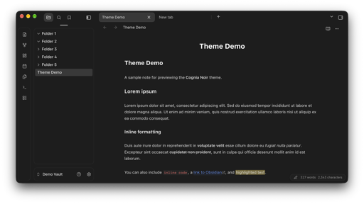
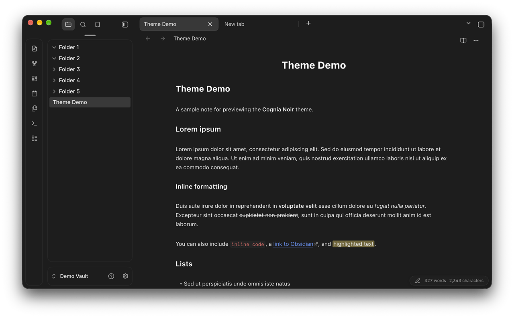
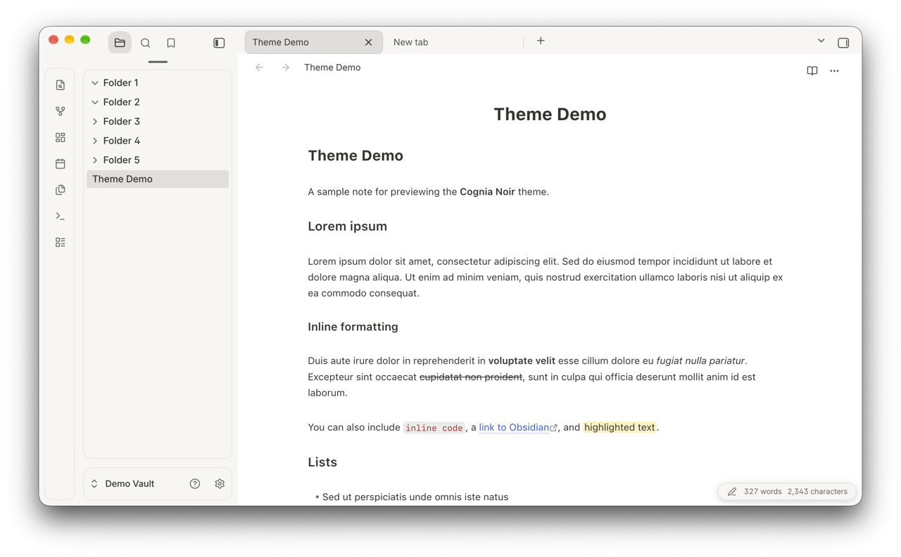
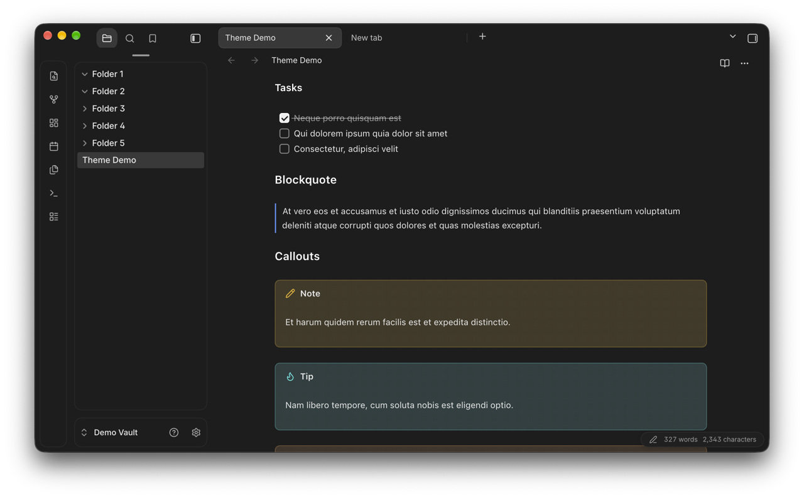
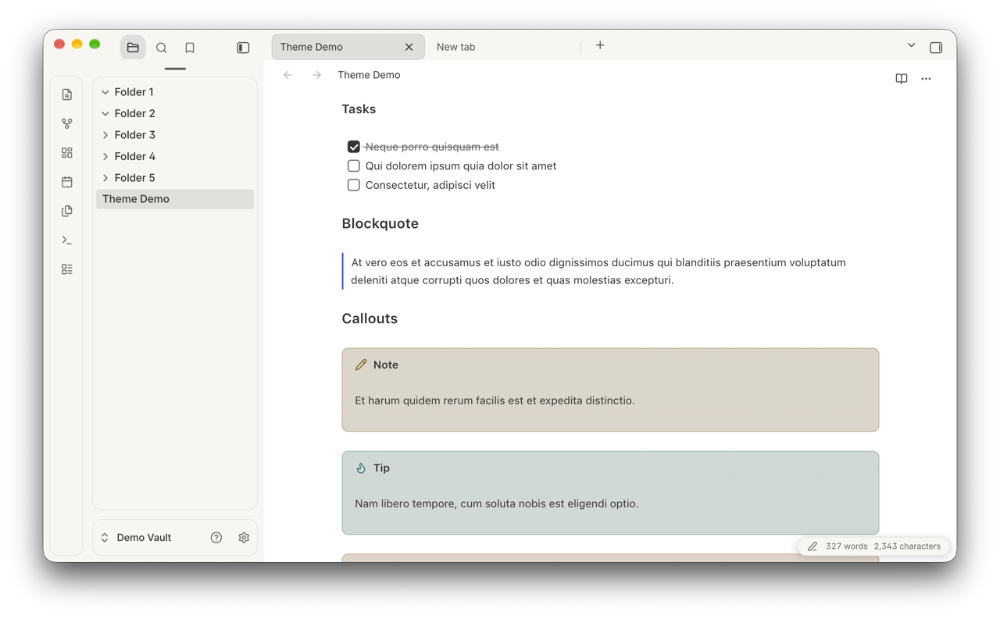
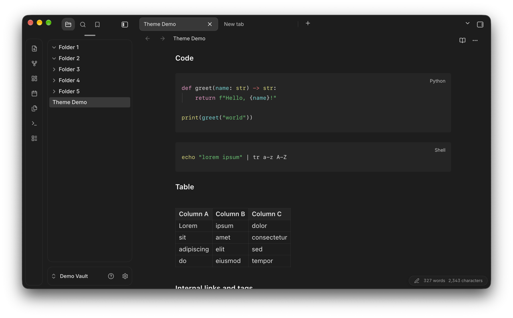
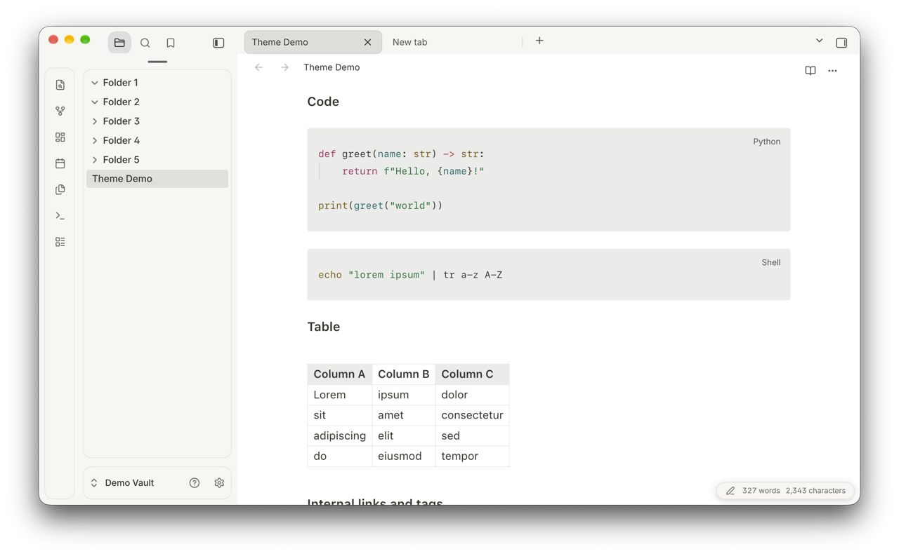
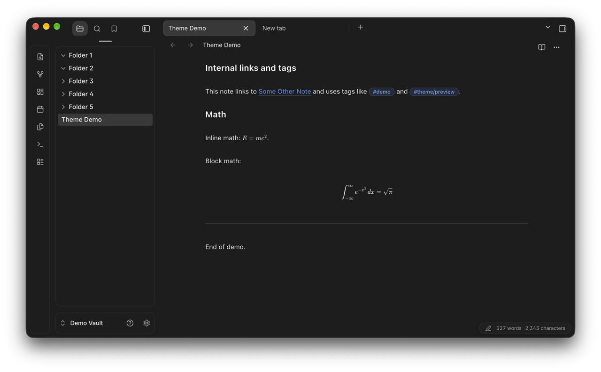
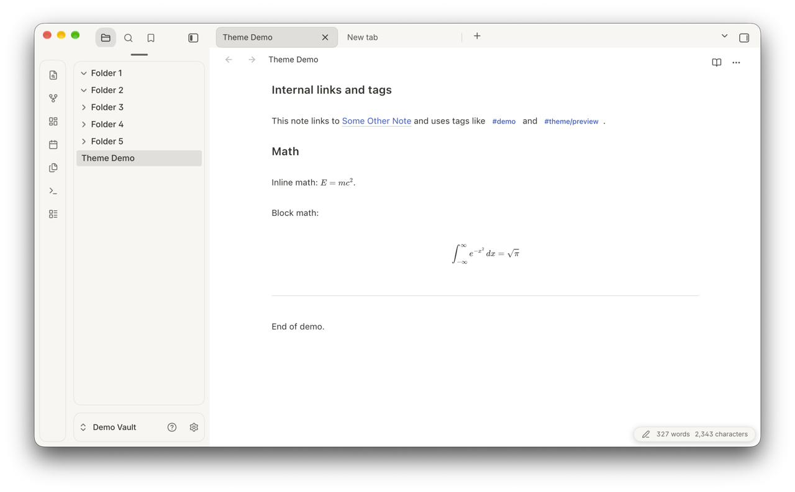

# Cognia Noir

Cognia Noir is a minimal dark and light theme for Obsidian, modeled on Notion's layout and colors. It supports macOS translucent windows. You can change most of its look with the Style Settings plugin.

  

## What it does

- Dark mode has seven background tones and light mode has six. You choose each one separately.
- In dark mode, the note, the sidebars, and the top bar use the same color. In light mode with the default tone, the note is white and the sidebar is off-white. In both modes, each sidebar panel has a thin outline.
- On desktop, tabs are rounded and the status bar is a small rounded box in the bottom-right corner.
- The default fonts are Inter for the interface, SF Pro Text for notes and headings, and SF Mono for code. An interface font or text font set in Settings > Appearance replaces the theme's UI font or note font. Headings follow the theme's **Heading font** setting either way.
- Callouts, tags, tables, task lists, and code blocks are styled to match the theme.
- **Grayscale UI** turns the theme's colors gray. Images in notes and code syntax highlighting keep their color.
- Printing and PDF export use dark text on a white page in both modes.

## Install

### From the community store

1. In Obsidian, go to Settings > Appearance > Manage > Browse.
2. Search for "Cognia Noir".
3. Click Install, then Use.

### Manually

1. Download `manifest.json` and `theme.css` from the latest release.
2. Put both files in `<your-vault>/.obsidian/themes/Cognia Noir/`.
3. In Settings > Appearance, select "Cognia Noir" under Theme.

## Settings

The settings require the [Style Settings](https://github.com/mgmeyers/obsidian-style-settings) plugin. There are 18 of them, in four groups: Color, Surfaces, Typography, and Layout. The lists below follow the order in the Style Settings panel.

### Color

- **Accent color**: used for links, focus outlines, and selection. Default `#5b8def` in dark mode, `#3a5fc7` in light mode.
- **Accent button label color**: text color on accent-colored buttons; change it if you change the accent. Default `#111111` in dark mode, `#ffffff` in light mode.
- **Inline code color**: text color of inline code. Default `#ee6666` in dark mode, `#a8201a` in light mode.
- **Grayscale UI**: on or off. Turns the accent, links, callouts, tags, highlights, inline code, and status colors gray. Default off.

### Surfaces

- **Dark mode background**: Charcoal, Slate (neutral gray), Graphite (deep neutral), Pure black (OLED), True black (#000), Warm charcoal, or Zen (soft warm gray). Default Charcoal. No effect in light mode.
- **Light mode background**: Paper, Pure white, Mist (light gray), Stone (deeper gray), Warm paper, or Zen (soft warm). Default Paper. No effect in dark mode.
- **Sidebar contrast**: Flat, Subtle border, or Lifted (slightly darker). Default Flat.
- **Translucency tint**: Pure vibrancy, Light, Medium, or Heavy. Default Medium. Applies only in dark mode with translucent windows on.

### Typography

- **Heading scale**: Compact, Comfortable, or Large. Default Comfortable.
- **Editor font size**: slider from 12 to 20, default 14. This is the note text size in pixels when Obsidian's own font size is at its default of 16; Obsidian's font size setting and zoom scale it from there.
- **UI font**: Inter, Avenir Next, or System (SF Pro). Default Inter.
- **Note font**: SF Pro, New York (Apple serif), Georgia (classic serif), or Avenir Next. Default SF Pro.
- **Heading font**: SF Pro, New York (Apple serif), or Georgia (classic serif). Default SF Pro.
- **Note title alignment**: Centered or Left. Default Centered.
- **Note line height**: slider from 1.4 to 2.0 in steps of 0.05, default 1.65.

### Layout

- **Line width**: maximum width of the note text. Slider from 500 to 1400 px in steps of 50, default 700 (the same as Obsidian's default).
- **Bubble nav buttons**: on or off. Hides the button row at the top of the file explorer and bookmarks (new note, new folder, sort, expand) until you hover over it. Default on.
- **Hide header title**: on or off. Hides the note title next to the back and forward arrows in Markdown notes. It only works while Obsidian's "Show inline title" is on, so the title stays visible in the tab and at the top of the note. Default off.

## Translucent windows (macOS)

Turn on Settings > Appearance > Translucent window. In dark mode, the window background becomes partly see-through, so your desktop shows behind the note and sidebars. Light mode stays opaque. The effect is off in full screen.

**Translucency tint** sets how much of the background color covers the desktop. Pure vibrancy is the most see-through and Heavy is the least. If **Sidebar contrast** is set to Lifted, the sidebars stay solid.

These views stay opaque: core Canvas, Excalidraw, Kanban, the Smart Connections view, and the Terminal plugin.

## Accessibility

Body text, headings, links, inline code, and tags meet WCAG AA (4.5:1) against the note background in every background tone, in both modes. This covers the default colors; if you set your own accent or inline code color, check its contrast yourself.

The theme's own transitions turn off when the system Reduce Motion setting is on. Keyboard focus is shown with an outline in the accent color.

## Compatibility

Cognia Noir requires Obsidian 1.13.4 or newer. It is built and tested on macOS. It has not been tested on Windows or Linux. Phone and tablet layouts are styled. They were checked in Obsidian's mobile emulation on a Mac, not on a device.

## Gallery

### Overview

A sample note with body text, inline formatting, a link, inline code, and lists.

| Dark | Light |
| --- | --- |
|  |  |

### Tasks, blockquote, callouts

| Dark | Light |
| --- | --- |
|  |  |

### Code blocks and tables

| Dark | Light |
| --- | --- |
|  |  |

### Internal links, tags, math

| Dark | Light |
| --- | --- |
|  |  |

## Changelog

See [CHANGELOG.md](CHANGELOG.md) for the changes in each release.

## License

MIT. See [LICENSE](LICENSE).

## Credits

The tab pills, header buttons, collapsing file explorer buttons, and sidebar panel boxes are based on ideas from the Velocity theme. The translucency and color-variant techniques came from studying AnuPpuccin, Things, and Catppuccin, and the Zen tones are named after the Zen browser. No CSS from these projects is copied.
